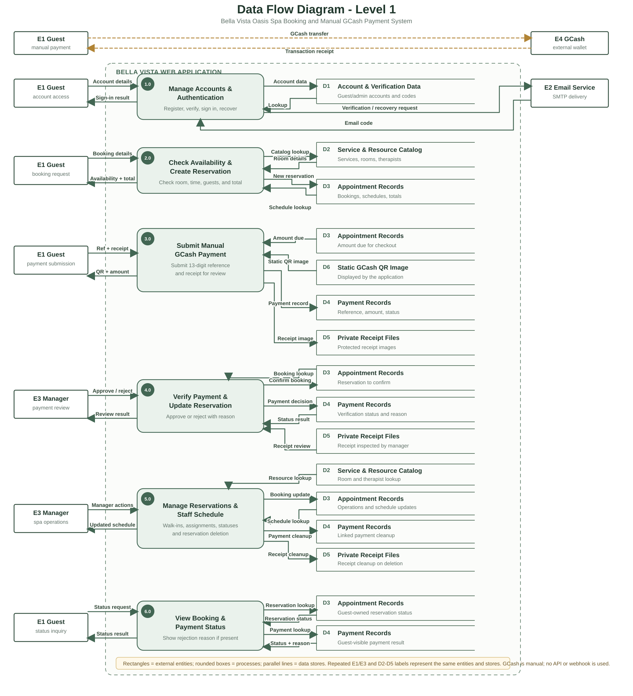

# Data Flow Diagram — Level 1

## External entities

- **E1 Guest** — registers or signs in, requests availability, creates a reservation, submits payment details and a receipt, and checks booking/payment status.
- **E2 Email service** — delivers account verification and recovery codes.
- **E3 Manager** — reviews payments and operates reservations, walk-ins, therapist assignments, booking statuses, and deletion.
- **E4 GCash app** — receives the guest's manual transfer and provides the guest with a transaction receipt. It is not integrated with the web application.

## Processes

1. **Manage Accounts & Authentication** — handles guest and manager account authentication, registration, verification, and recovery.
2. **Check Availability & Create Reservation** — checks the service/room catalog and existing appointments, calculates the total, and records the reservation.
3. **Submit Manual GCash Payment** — displays the static QR and reservation amount, accepts the reference number and receipt image, and stores the payment for review.
4. **Verify Payment & Update Reservation** — lets the manager inspect the submitted reference and receipt, then approve or reject the payment. Approval updates an eligible reservation to confirmed; rejection records its reason.
5. **Manage Reservations & Staff Schedule** — supports walk-in bookings, therapist assignment, booking status changes, and manager-controlled deletion.
6. **View Booking & Payment Status** — returns the signed-in guest's reservation and payment result, including a rejection reason when present.

## Data stores

- **D1 Account & Verification Data** — guest and manager accounts and account-verification data in MySQL.
- **D2 Service & Resource Catalog** — services, rooms, and therapists.
- **D3 Appointment Records** — guest and walk-in bookings, schedules, totals, assignments, and reservation statuses.
- **D4 Payment Records** — GCash reference, amount, receipt path, payment status, rejection reason, and verification details.
- **D5 Private Receipt Files** — uploaded receipt screenshots stored outside the database in protected storage.
- **D6 Static GCash QR Image** — the QR image asset displayed by the application.

## Process input and output summary

| Process | Main inputs | Data stores used | Main outputs |
|---|---|---|---|
| 1. Manage Accounts & Authentication | Registration, sign-in, verification, and recovery details | D1 | Authentication result; verification or recovery email request |
| 2. Check Availability & Create Reservation | Service, room, date/time, and guest details | D2, D3 | Availability, reservation details, and amount due |
| 3. Submit Manual GCash Payment | Payment reference number and receipt screenshot | D3, D4, D5, D6 | Pending-verification payment and submission result |
| 4. Verify Payment & Update Reservation | Manager approval/rejection and rejection reason | D3, D4, D5 | Updated payment result and reservation status |
| 5. Manage Reservations & Staff Schedule | Walk-in details, therapist assignment, status change, or deletion | D2, D3, D4, D5 | Updated schedule and booking records; linked payment/receipt cleanup on deletion |
| 6. View Booking & Payment Status | Guest's status request | D3, D4 | Reservation status, payment status, and rejection reason when applicable |

## Payment-flow note

The guest scans the static QR and transfers funds in the GCash app. The guest then submits the 13-digit reference number and receipt screenshot to the web application. Payment verification is manual; the system does not call a GCash API or receive a webhook.

## Diagram notation

The diagram repeats some external-entity and data-store symbols to keep related flows local and readable. Repeated E1/E3 symbols refer to the same Guest/Manager, and repeated D2–D5 symbols refer to the same logical data stores; they are not separate accounts, catalogs, appointment tables, payment tables, or receipt repositories.
